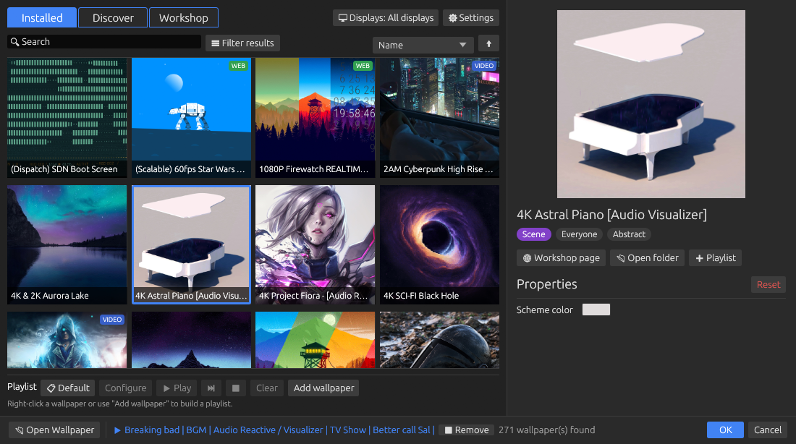

# wp-engine

<p>
  <a href="LICENSE"></a>
  
  
  
</p>

**Renders**&nbsp;


**Presents on**&nbsp;


**Built on**&nbsp;


A Wallpaper Engine client for Linux and macOS, written in Rust.

`wp-engine` plays Steam Workshop wallpapers on your desktop: animated **scene**
wallpapers rendered through a `wgpu` pass pipeline, plus video, image, and
(optionally) web wallpapers. It reads Wallpaper Engine's own formats directly —
`scene.json`, `.pkg` archives, `.tex` textures, `.mdl` models — so Workshop
items you already own work as-is.

The scene renderer is a port of
[linux-wallpaperengine](https://github.com/Almamu/linux-wallpaperengine); a
great deal of the maths here is based on that project's work. See
[Credits](#credits).


| | | |
| --- | --- | --- |
|  |  |  |
| Scene passes and effects | Scripted live text | Particles, audio reactive |

---

## Contents

- [Highlights](#highlights)
- [Requirements](#requirements)
- [Installation](#installation)
- [Usage](#usage)
- [Configuration](#configuration)
- [Project status](#project-status)
- [Architecture](#architecture)
- [Development](#development)
- [Troubleshooting](#troubleshooting)
- [Credits](#credits)
- [License](#license)

## Highlights

| | |
| --- | --- |
| **Scene wallpapers** | The full pass model — material and effect passes, ping-pong FBOs, named render targets, multi-pass effects, and the bloom chain |
| **Particles** | Every emitter, initializer, operator, and renderer type the Workshop corpus uses, including rope/trail geometry and textured sprites |
| **Shader translation** | Workshop GLSL compiled to SPIR-V and translated to WGSL at load, with repair passes for the legacy GLSL real wallpapers ship |
| **Audio reactive** | Desktop audio captured and FFT'd into the `g_AudioSpectrum*` uniforms, driving visualisers and particle emission |
| **Scripting** | Wallpaper Engine's SceneScript property scripts, for live text, opacity, visibility, and transforms |
| **Puppets and 3D** | `.mdl` skeletal meshes with skinning and animation layers, and perspective scenes |
| **Native presentation** | Direct `wgpu::Surface` presentation on Wayland — no readback — plus GNOME (via a Shell extension), X11 desktops and bare window managers, macOS, and a CPU fallback everywhere |
| **Desktop app** | A browser laid out like Wallpaper Engine's: click to apply per display, filters, playlists, live property editing, and a background daemon with a tray icon |

## Requirements

- **Rust** (stable) and Cargo
- **A GPU with Vulkan or Metal** — a software rasteriser works but is slow
- **shaderc** — GLSL to SPIR-V, for the shader translation layer
- **FFmpeg 9 or newer** — video decoding
- **Wallpaper Engine content** — Workshop items under your Steam library. The
  app finds them automatically.

Presentation needs one of:

| Platform | Requirement |
| --- | --- |
| Wayland | a compositor with `wlr-layer-shell` (Sway, Hyprland, river, labwc, wayfire, KDE, COSMIC, …) |
| GNOME (Wayland) | the bundled Shell extension — see [GNOME](#gnome) |
| X11 | any window manager or desktop (KDE, Xfce, GNOME, Cinnamon, MATE, …) |
| macOS | no extra requirement (scenes only, primary display — see [Known gaps](#project-status)) |

Windows is out of scope — see [Project status](#project-status).

## Installation

### Prebuilt archives

[Releases](https://github.com/code-wolf-byte/open-wallpaper-engine/releases)
carry `wp-engine-<version>-linux-x86_64.tar.gz` and a `-web` variant with the
embedded Chromium for web wallpapers. Unpack anywhere and run `./wp-engine`;
the web variant keeps its Chromium files beside the binary, so leave the folder
together. The binary links shaderc and FFmpeg dynamically, so install those
(below) — an archive needs the same major FFmpeg version it was built against.
If yours differs, build from source.

### From source

Install the two native libraries first. Cargo links against them and cannot
fetch them like crates:

```bash
# Debian / Ubuntu
sudo apt install libshaderc-dev ffmpeg

# Arch
sudo pacman -S shaderc ffmpeg

# macOS
brew install shaderc ffmpeg
```

Then build:

```bash
git clone https://github.com/code-wolf-byte/open-wallpaper-engine
cd open-wallpaper-engine
cargo build --release
```

The binary lands at `target/release/wp-engine`.

On macOS, Homebrew's prefix is not on `shaderc-sys`'s search path, so point the
build at it:

```bash
export SHADERC_LIB_DIR=/opt/homebrew/lib
```

Keep that out of version control — a committed global path breaks Linux builds.

### Web wallpapers (optional)

Web wallpapers need an embedded Chromium and sit behind an off-by-default cargo
feature:

```bash
cargo build --release --features web
```

The first such build downloads the CEF binary distribution (~400 MB extracted)
and places `libcef.so`, Chromium's resource blobs, and `locales/` beside the
binary; `build.rs` adds an `$ORIGIN` rpath so it finds them. Set `CEF_PATH` to
reuse an existing CEF distribution instead of downloading one.

Leave the feature off unless you need web wallpapers — the default build touches
none of this, and without it web wallpapers report that the binary lacks web
support rather than failing obscurely.

### GNOME

GNOME doesn't implement `wlr-layer-shell`, so there wp-engine opens one plain
window per monitor and a small GNOME Shell extension (GNOME 45+) moves it into
the desktop background. Install and enable it once, then log out and back in:

```bash
cp -r extras/gnome-shell-extension/wp-engine@code-wolf-byte.github.io \
  ~/.local/share/gnome-shell/extensions/
gnome-extensions enable wp-engine@code-wolf-byte.github.io
```

Without the extension the wallpaper shows up as an ordinary window.
`WP_ENGINE_XDG_WALLPAPER=1` forces this window mode on any compositor, for
testing.

## Usage

Run with no arguments for the graphical browser:

```bash
wp-engine
```



Or drive it from the command line:

```bash
# List everything Wallpaper Engine has installed
wp-engine list

# Apply a wallpaper by Workshop ID — returns immediately; the wallpaper keeps
# running in the background daemon (started automatically on first use)
wp-engine set 1275921440

# Apply any scene directory, video, image, or HTML file
wp-engine set-file ~/wallpapers/my-scene/

# Override a wallpaper's user properties (repeatable)
wp-engine set 1275921440 --set-property "schemecolor=1 0.2 0.2"

# See what's showing, or remove it and stop the daemon
wp-engine status
wp-engine stop
```

On Linux there is only ever one renderer: `set`, `set-file`, `run`, and the GUI
all hand their wallpaper to a single background daemon, replacing whatever it
was showing, so the wallpaper keeps running after the terminal or GUI window
closes. Pass `--foreground` to `set`/`set-file`/`run` to render in the current
process until Ctrl-C instead. To start the wallpaper with your session, run
`wp-engine autostart on` (an XDG autostart entry for `wp-engine run`, which
restores your saved `config` setup), or run `wp-engine daemon` as a service and
`wp-engine run` after it. The daemon shows a tray icon with playlist controls
and a shortcut back to the GUI; set `WP_ENGINE_NO_TRAY=1` to hide it.

The GUI follows Wallpaper Engine's own browser. Clicking a wallpaper applies it
to the display picked under **Displays** (all of them by default), the right-hand
panel edits its properties, the bar under the grid builds and plays playlists,
and **⚙ Settings** holds playback rules, quality, frame rate, audio and
autostart. **Cancel** restores what was showing when the window opened.
The daemon's socket and lock live in `$XDG_RUNTIME_DIR/wp-engine/`; a daemon
started in the background logs to `$XDG_STATE_HOME/wp-engine/daemon.log`.

| Command | Purpose |
| --- | --- |
| `list` | List installed Workshop wallpapers |
| `set <id>` | Apply a wallpaper by Workshop ID |
| `set-file <path>` | Apply a scene directory, video, image, or HTML file |
| `playlist play <name>` | Rotate through a saved playlist (`next`, `previous`, `stop`) |
| `config …` | Saved settings: properties, screens, playlists, playback rules, FPS, scaling |
| `autostart on\|off` | Start `wp-engine run` at login |
| `run` | Apply the saved `config` setup (per-screen wallpapers, default) |
| `status` | Show what the background daemon is displaying |
| `stop` | Remove the wallpaper and stop the background daemon |
| `daemon` | Run the daemon in the foreground (normally auto-started) |
| `info <id>` | Show a Workshop item's metadata |
| `list-properties <id>` | Show the properties a wallpaper exposes |
| `probe` | List GPU adapters and screen names |
| `pkg-info <path>` | Inspect or extract a `.pkg` archive |
| `tex-info <path>` | Inspect a `.tex` texture |
| `render-scene <id>` | Render one frame to a PNG |
| `render-frame <id>` | Render a video, image or web wallpaper's frame to a PNG |
| `preview-scene <id>` | Preview an animated scene in a window |
| `test-scene <id>` | Check that a scene animates, headless |

Add `-v` for debug logging, `-vv` for trace. `RUST_LOG` overrides both.

## Configuration

### User properties

Wallpapers expose their own settings — colours, speeds, toggles. List them with
`wp-engine list-properties <id>` and override them with `--set-property
NAME=VALUE`, which is applied before `scene.json` is parsed.

### Playback, playlists and display

```bash
# Pause behind fullscreen apps, mute while another app plays audio
wp-engine config set-playback fullscreen pause
wp-engine config set-playback audio mute
wp-engine config set-fps 60
wp-engine config set-scaling fit          # fill, fit, stretch, center
wp-engine config set-layout span          # per-screen, span, clone

# A playlist that changes every 30 minutes, played by `wp-engine run`
wp-engine config set-playlist evening 1275921440 2156479578 --delay 30
wp-engine config set-active-playlist evening
```

`wp-engine config --help` lists every setting.

### Environment variables

| Variable | Effect |
| --- | --- |
| `WP_ENGINE_FORCE_X11=1` | Take the X11 path even under a Wayland session |
| `WP_ENGINE_X11_MODE=root\|window` | On X11, draw only on the root window, or in a desktop window too (the default where the window manager supports one) |
| `WP_ENGINE_XDG_WALLPAPER=1` | Use the GNOME-style plain window instead of layer-shell |
| `WP_ENGINE_FORCE_SHM=1` | Force the CPU/SHM presentation path |
| `WP_ENGINE_SKIP_EFFECTS=a,b` | Disable named effects |
| `WP_ENGINE_NO_TRAY=1` | Run the daemon without a tray icon |
| `WP_ENGINE_PAUSE_ON_{FOCUS,MAXIMIZED,FULLSCREEN,AUDIO,BATTERY,LOCK}` | Override a playback rule (`run`/`mute`/`pause`/`stop`) |
| `CEF_PATH` | Reuse an existing CEF distribution instead of downloading one |
| `SHADERC_LIB_DIR` | Where to find shaderc, if not on the default search path |
| `RUST_LOG` | Standard `tracing` filter; overrides `-v` |

Diagnostic dumps are listed under [Troubleshooting](#troubleshooting).

## Project status

The scene renderer targets the Workshop corpus rather than the format's full
theoretical surface: features are measured against real wallpapers before being
built, and several are deliberately skipped as unreachable.

<details>
<summary><strong>Implemented</strong></summary>

- asset store for loose files and PKG archives
- tolerant `scene.json` parsing with user-property resolution
- model/material/effect parsing
- GLSL→WGSL shader translation (shaderc + Naga) with std140 uniform packing and
  the legacy-GLSL repair passes real workshop shaders need
- full effect pass chaining: ping-pong FBOs, named effect FBOs (`target`/`bind`),
  multi-pass effects, per-object composite buffers, reference bloom chain
- per-object quad placement (WE scene coordinates, Y-up), layer alignment,
  parent-chain transforms, true z-order interleaving
- particles: every emitter/initializer/operator/renderer type the corpus uses,
  including rope/trail renderers, textured sprites, child systems, and
  audio-reactive emission
- puppet `.mdl` mesh loading with bones, skinning, and animation layers
- text objects: system + bundled fonts, wrapping, alignment, backgrounds
- light and sound objects
- SceneScript: persistent per-object scripts with `init`/`update`, the
  `thisLayer`/`thisScene`/`engine`/`input`/`shared` APIs, cursor events,
  sounds, texture animations, effect and material access, created layers
- property animations (keyframed timelines with events)
- presets (Workshop items that restyle another wallpaper)
- audio reactivity: desktop capture → FFT → `g_AudioSpectrum*` uniforms
- camera shake / fade / parallax, driven by the real cursor
- 3D perspective scenes with meshes
- composition/fullscreen layers that sample the scene behind them
  (water, refraction, CRT effects)
- video wallpapers with audio, and embedded-video `.tex` layers, streamed with
  FFmpeg; fill/fit/stretch/center scaling
- web (HTML) wallpapers via CEF at the output's resolution, with the WE browser
  API bridge (properties, audio, media integration, mouse input)
- playback rules (run/mute/pause/stop while another app is focused, maximized,
  fullscreen or playing audio, on battery, or while locked), FPS cap
- playlists: timer, time of day, day of week, or once per login
- multiple monitors: a wallpaper per screen, one spanned across all of them,
  or one cloned onto each
- presentation: Wayland layer-shell (direct `wgpu::Surface`, no readback),
  X11 desktop window (root pixmap on bare WMs), macOS desktop window, CPU/SHM fallback everywhere
- application lifecycle (`WallpaperApplication`, `--set-property`, signals)

</details>

<details>
<summary><strong>Known gaps</strong></summary>

- Workshop browsing and downloading — the GUI's Discover and Workshop tabs open
  the Steam Workshop website; subscribe there (or in Steam) and the items show up
- **macOS** is an early port: scene wallpapers only, on the primary display, no
  background daemon, playlists or tray, settings and per-wallpaper properties
  not yet applied, no cursor input, and audio-reactive wallpapers need a
  loopback driver such as BlackHole
- **GNOME** needs the bundled Shell extension, which has had little testing; the
  overview shows GNOME's own wallpaper, and pausing behind fullscreen apps
  doesn't work there (GNOME doesn't share window states)
- **KDE and Xfce on X11**: the wallpaper window sits above the desktop's own
  layer, so desktop icons are hidden (they still respond to clicks); on Wayland
  KDE is unaffected
- pausing behind fullscreen/maximized apps on Wayland needs
  `wlr-foreign-toplevel-management` (Sway, Hyprland, river, …), so KDE Wayland
  doesn't pause either
- hardware video decoding
- only one web wallpaper at a time; keyboard input isn't forwarded to web
  wallpapers, and X11 doesn't forward the scroll wheel or middle button
- playlist transitions (items switch with a hard cut)
- per-object cameras (3 wallpapers in the local corpus)
- normal-mapped lighting, shadows, volumetrics, GPU instancing, and a true depth
  buffer — all measured against the corpus and found to have zero or near-zero
  reach, so they are deliberately not planned rather than merely missing

</details>

<details>
<summary><strong>Out of scope</strong></summary>

- **Windows.** The renderer is portable (wgpu), but there is no `WorkerW`
  platform module and no way to test one from the Linux/macOS development
  environment. `application` (Windows-only `.exe`) wallpapers likewise.

</details>

## Architecture

A wallpaper becomes pixels in stages: content detection, asset mounting, tolerant
`scene.json` parsing, model/material/effect resolution, scene-graph composition,
shader translation, then the GPU pass pipeline and platform presentation.

**[Read the full architecture guide →](ARCHITECTURE.md)**

## Development

```bash
cargo fmt
cargo clippy
cargo test
```

`cargo test` runs the unit suite. For rendering work, `test-scene` is the fastest
signal — it drives the real GPU path headlessly, so it catches what unit tests
cannot.

### Releasing

`scripts/release.sh` runs the checks, builds, and packs
`dist/wp-engine-<version>-<os>-<arch>[-web].tar.gz` with a `.sha256`:

```bash
scripts/release.sh                          # package the current version
scripts/release.sh --web                    # Linux: bundle Chromium for web wallpapers
scripts/release.sh --version 0.2.0 --tag    # bump, commit "release: v0.2.0", tag v0.2.0
```

It never pushes; push the branch and tag, then attach both archives (and their
`.sha256` files) to a GitHub release. Build on the oldest distribution you want
to support, since the binary links that system's FFmpeg and shaderc.

## Troubleshooting

**Nothing appears on Wayland.** The compositor needs `wlr-layer-shell`; on GNOME,
install the [Shell extension](#gnome). A window titled "wp-engine wallpaper @…"
means the extension isn't enabled.

**A wallpaper renders wrongly.** Reach for the dumps before reading code:

- `wp-engine test-scene <id>` — headless animation check
- `WP_DEBUG_DUMP_FRAME=path` — save the last GPU frame (the only way to inspect
  the live path off-screen)
- `WP_DEBUG_DUMP_FBOS=1` — dump every pooled render target per frame
- `WP_DEBUG_DUMP_WGSL=1` / `WP_DEBUG_DUMP_GLSL=1` — dump translated WGSL, or the
  generated GLSL of any shader that fails to compile
- `WP_DEBUG_TEX_SLOTS=1` — dump effect texture-slot resolution
- `WP_DEBUG_PARTICLE_TIMING=1` — per-system particle cost, for "why is this slow"
- `WP_ENGINE_SKIP_EFFECTS=name1,name2` — disable specific effects. Note the
  hardcoded kernels (pulse/scroll/shake/tint/opacity/waterripple/waterwaves/spin)
  never log a load line, so read the object's effect list from `scene.json`
  rather than trusting the log when bisecting.
- `WP_ENGINE_FORCE_SHM=1` — force the CPU/SHM presentation path
- `WP_ENGINE_FORCE_X11=1` — take the X11 path even under a Wayland session
- `WP_ENGINE_X11_MODE=root|window` — on X11, draw only on the root window
  (bare window managers' default) or in a desktop window (the default where
  the window manager supports EWMH desktop windows)
- `WP_ENGINE_XDG_WALLPAPER=1` — use the GNOME-style window instead of layer-shell

**A web wallpaper says the binary lacks web support.** It was built without
`--features web`; see [Installation](#installation).

## Credits

This project would not exist without
**[Almamu/linux-wallpaperengine](https://github.com/Almamu/linux-wallpaperengine)**
— Almamu's C++ reverse-engineering of Wallpaper Engine's scene format and
renderer.

A great deal of the maths in this codebase is based on the work done there. The
formats and formulae were derived by that project first, and this port follows
them:

- the pass model: material and effect passes, ping-pong FBOs, named render
  targets, and the bloom chain
- particle simulation — emitter shapes, initializers, and the operator formulae
  (`alphafade`, `sizechange`, the oscillators, `colorchange`,
  `controlpointattract`) follow `CParticle.cpp`
- the `.tex` container format, the `.mdl` mesh layout, and the texture/model
  chain resolution rules
- scene coordinates, layer alignment and quad placement (`CImage.cpp`), and text
  layout (`CText.cpp`)
- camera parallax and fade, and the pointer-position convention
- shader translation: uniform naming, combo handling, and the binding rules
  `CPass.cpp` establishes

Some parts went further than the reference and are original work here, informed
by its groundwork rather than ported from it: the puppet `.mdl` skeleton and
animation tracks (the reference reads only the mesh, and rejects the format
version these files use), rope/trail particle geometry, and the Wallpaper Engine
JavaScript bridge for web wallpapers.

Where this port deviates deliberately, the reason is recorded in a comment next
to the code (camera shake, for instance, is applied here even though the
reference parses but never applies it).

The reference implementation is not redistributed here — `cpp-implementation/`
is gitignored, and is a local checkout used as read-only reference material
while porting. Clone it yourself from the link above if you want to compare.

Wallpaper Engine itself is a product of Kristjan Skutta. This project is not
affiliated with, endorsed by, or derived from its source.

## License

Licensed under the **GNU General Public License v3.0** — see [LICENSE](LICENSE).

`linux-wallpaperengine`, which this project derives from and whose maths it is
based on, is GPL-3.0. As a derivative work this project carries the same license.
Upstream ships the GPL-3 text with no "or any later version" grant, so this is
GPL-3.0-only rather than -or-later.
